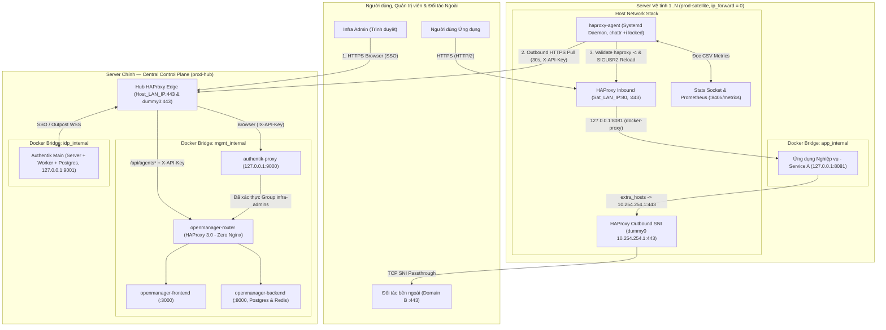
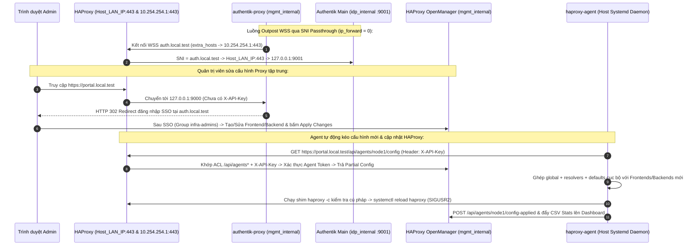

# BUSINESS & TECHNICAL REQUIREMENTS DOCUMENT (BRD)
## Dự án: Nền tảng Proxy Tập trung HAProxy (Zero-IP-Forward) & Control Plane Quản trị Đa Cụm (Authentik SSO + HAProxy OpenManager Pull-Agent)

| Thông tin tài liệu | Chi tiết |
| :--- | :--- |
| **Mã dự án** | `RPA-REVERT-PROXY` |
| **Phiên bản** | `1.1.0` |
| **Ngày cập nhật** | `2026-11-25` |
| **Trạng thái** | Đã hiệu chỉnh toàn diện sau Technical Review — Sẵn sàng PoC & Kiểm thử Nghiệm thu |
| **Phạm vi triển khai** | Hỗ trợ đồng thời **Mô hình 1 Server (`local-all-in-one`)** và **Mô hình Đa Server (`prod-hub` + `prod-satellite`)** |

### Lịch sử Phiên bản
| Phiên bản | Ngày | Nội dung thay đổi chính |
| :--- | :--- | :--- |
| `1.0.0` | `2026-11-25` | Bản đặc tả đầu tiên sử dụng mô hình Roxy-WI phân tán trên từng node vệ tinh kết hợp SSH cục bộ. |
| `1.1.0` | `2026-11-25` | **Tái kiến trúc Control Plane sang `haproxy-openmanager` (Central Hub + Pull Agent qua HTTPS)**:<br>1. Quản trị tập trung toàn bộ các Server vệ tinh trên **01 giao diện duy nhất**, loại bỏ hoàn toàn SSH quản trị và gỡ bỏ gánh nặng container Roxy-WI/RabbitMQ khỏi các node vệ tinh.<br>2. Loại bỏ `100%` thành phần NGINX (kể cả container `nginx` mặc định trong OpenManager, thay bằng `openmanager-router` chạy `haproxy:3.0-alpine`).<br>3. Khóa bất biến `haproxy-agent` (`chattr +i`) chống RCE từ tính năng tự nâng cấp script từ xa; tách biệt khóa TLS `0600` với tiến trình worker UID `99`.<br>4. Bổ sung kiểm soát IPv6, `FR-03A` (Outbound Egress Enforcement), chuẩn hóa SLO Graceful Drain (`hard-stop-after`), Observability (Prometheus Exporter + Live Stats), Disaster Recovery (`RPO`/`RTO`) và 7 cổng kiểm thử PoC độc lập. |

---

## 1. Bối cảnh & Đặt vấn đề (Background & Problem Statement)

### 1.1. Hiện trạng & Thách thức
1. **Rủi ro cảnh báo bảo mật (CVE):** Hệ thống reverse proxy hiện hữu sử dụng NGINX thường xuyên phát sinh cảnh báo lỗ hổng bộ nhớ và thư viện phụ thuộc trong các đợt kiểm toán an toàn thông tin (Security Audit).
2. **Ràng buộc hạ tầng mạng nghiêm ngặt (OS & Firewall Hardening):**
   * Toàn bộ máy chủ bắt buộc tắt định tuyến gói tin ở tầng Kernel: `net.ipv4.ip_forward = 0` (và không cho phép đi vòng qua IPv6).
   * Các ứng dụng nghiệp vụ chạy trong Docker ở chế độ mạng `bridge` cô lập (không được phép dùng `network_mode: host`). Khi `ip_forward = 0`, các container này mất hoàn toàn khả năng gọi trực tiếp ra Internet hoặc tới các hệ thống đối tác bên ngoài.
   * Chính sách Firewall giữa các máy chủ **cấm mở cổng SSH (`Port 22`) liên server** và cấm mở các cổng quản trị từ bên ngoài chọc thẳng vào các máy chủ vệ tinh.
3. **Nhu cầu Quản trị Tập trung, Giám sát Thực thi & Xác thực SSO:**
   * Đội ngũ vận hành cần **một Control Plane Web UI mã nguồn mở duy nhất** để quản lý cấu hình, xem lịch sử phiên bản (Diff/Rollback), quản lý chứng chỉ SSL và giám sát lưu lượng thực tế của toàn bộ các máy chủ vệ tinh mà không tốn chi phí license thương mại.
   * Giao diện quản trị bắt buộc được bảo vệ bởi lớp cổng xác thực tập trung **SSO/OIDC (Authentik)** nhằm chặn `100%` truy cập chưa xác thực (Pre-auth) từ bên ngoài.

### 1.2. Tầm nhìn Giải pháp
Xây dựng nền tảng Proxy và Quản trị Tập trung dựa trên **HAProxy 3.0 LTS + Authentik SSO + HAProxy OpenManager (Pull-Agent Architecture)**:
* **Data Plane trên từng máy chủ:** HAProxy (`network_mode: host`) xử lý đồng thời chiều **Inbound (HTTPS / HTTP/2)** và chiều **Outbound (TCP SNI Passthrough qua `dummy0`)** với `net.ipv4.ip_forward = 0`, không sửa code ứng dụng và không thay đổi chứng chỉ SSL gốc của đối tác.
* **Control Plane Tập trung (`Hub & Pull-Agent`):** Dựng duy nhất **01 cụm `haproxy-openmanager` + `Authentik Main` + `Authentik Proxy` tại Server Chính (Hub)**. Trên các **Server Vệ tinh (Satellites)** chỉ cài đặt daemon nhẹ **`haproxy-agent`** chủ động gọi **Outbound HTTPS (`:443`)** về Hub định kỳ để kéo cấu hình mới đã kiểm duyệt và đẩy số liệu thống kê thực tế lên Dashboard tập trung — hoàn toàn không cần mở SSH hay cổng quản trị Inbound trên các máy chủ vệ tinh.
* **Chế độ Kiểm thử 01 Server (`local-all-in-one`):** Triển khai đồng thời cả cụm Hub lẫn cụm Satellite + Agent trên **01 máy chủ Linux duy nhất** để chứng minh thực nghiệm toàn bộ luồng mạng và cơ chế đồng bộ cấu hình trước khi nhân rộng ra nhiều máy chủ.

---

## 2. Mục tiêu Dự án & Chỉ số Đo lường (Objectives & SLOs)

| Mã | Mục tiêu | Chỉ số đo lường (KPIs / SLOs) |
| :--- | :--- | :--- |
| **BO-01** | **Tuân thủ tuyệt đối Hardening & Chống rò rỉ Egress** | `sysctl net.ipv4.ip_forward = 0` và `net.ipv6.conf.all.forwarding = 0` bền vững qua khởi động lại Docker/OS; `0` cổng SSH liên server; `0` container NGINX trong toàn bộ hệ thống; `0` đường đi egress trái phép (IP trần, IPv6, UDP/QUIC) vượt qua HAProxy. |
| **BO-02** | **Tương thích 100% ứng dụng hiện hữu** | `0` dòng mã nguồn ứng dụng phải sửa đổi; `0` chứng chỉ Root CA giả lập phải nhúng vào container nghiệp vụ; hỗ trợ HTTP/2 chiều vào và bảo toàn TLS/mTLS gốc chiều ra. |
| **BO-03** | **Quản trị Tập trung 01 Màn hình & Bảo vệ Pre-Auth** | Quản lý toàn bộ `N` Server vệ tinh từ **01 Portal duy nhất** có sẵn Version Diff, 1-Click Rollback và Real-time Metrics; `100%` truy cập trình duyệt chưa xác thực vào Portal bị chặn tại `authentik-proxy` (`HTTP 302`/`403`). |
| **BO-04** | **Độ sẵn sàng vận hành & Phục hồi thảm họa (Graceful Drain & DR)** | Khi reload cấu hình: **`0%` kết nối mới bị từ chối**, các kết nối đang hoạt động được **graceful drain tối đa trong ngưỡng `hard-stop-after` (mặc định `60s`)** trước khi đóng cưỡng chế worker cũ; chỉ tiêu phục hồi thảm họa đạt **`RPO <= 24h`** và **`RTO <= 30 phút`**. |

---

## 3. Phạm vi Dự án (Project Scope)

### 3.1. Trong phạm vi (In-Scope)
* Chuẩn hóa tầng OS trên Linux (`Kernel >= 5.4`, `Docker Engine >= 24.0`): khóa IPv4/IPv6 forwarding, khởi tạo `dummy0` (`10.254.254.1/32`), cấu hình `/etc/docker/daemon.json`, thiết lập Egress/Ingress Firewall.
* Triển khai Data Plane **HAProxy 3.0 Alpine (`network_mode: host`)** qua systemd wrapper `haproxy.service`: tách biệt Inbound HTTP/2, Outbound TCP SNI Passthrough, Stats Socket và Prometheus Exporter nội bộ (`:8405/metrics`).
* Triển khai Control Plane **Central Hub** (`Authentik Main` gồm `server` + `worker` + `postgresql`, `authentik-proxy`, và `haproxy-openmanager` đã thay thế Nginx bằng `openmanager-router` HAProxy).
* Xây dựng bộ cài đặt và khóa bảo mật **`haproxy-agent`** trên các Server vệ tinh: kết nối HTTPS Pull về Hub, cầu nối kiểm tra cú pháp/reload container HAProxy và khóa bất biến chống tự sửa script từ xa (`chattr +i`).
* Xây dựng ứng dụng kiểm thử `mock-app` và bộ kiểm thử nghiệm thu tự động theo **7 cổng kỹ thuật PoC/UAT**.

### 3.2. Ngoài phạm vi (Out-of-Scope)
* Hỗ trợ lưu lượng Outbound cho các giao thức không mang trường TLS SNI hoặc không dùng TCP (như QUIC/HTTP3 trên UDP `:443`, TLS Encrypted Client Hello - ECH che giấu SNI, hoặc gọi trực tiếp bằng địa chỉ IP trần không qua tên miền).
* Cân bằng tải mức DNS đa trung tâm dữ liệu (GSLB).

---

## 4. Kiến trúc Giải pháp Tổng thể (System Architecture)

### 4.1. Mô hình Sản xuất Đa Server (`prod-hub` + `prod-satellite`)



### 4.2. Mô hình Kiểm thử Trọn bộ Trên 01 Server (`local-all-in-one`)
Khi phát triển hoặc kiểm thử trên **01 máy chủ Linux duy nhất**, toàn bộ các thành phần của `HubServer` và `SatServer` cùng chạy trên một máy với `net.ipv4.ip_forward = 0`:



---

## 5. Yêu cầu Chức năng Chi tiết (Functional Requirements)

### FR-01: Chuẩn hóa Tầng Hệ điều hành, Khóa IPv4/IPv6 & Docker Daemon
1. **Ma trận nền tảng hỗ trợ:** Hệ điều hành Ubuntu 22.04/24.04 LTS hoặc RHEL/Rocky/AlmaLinux 8/9 (`Linux Kernel >= 5.4`), `Docker Engine >= 24.0` kèm `Docker Compose v2`.
2. **Vô hiệu hóa hoàn toàn định tuyến gói tin (IPv4 & IPv6):**
   * Cấu hình `/etc/sysctl.d/99-haproxy-zero-fwd.conf`: `net.ipv4.ip_forward = 0`, `net.ipv6.conf.all.forwarding = 0`, `net.ipv6.conf.default.forwarding = 0`, `net.ipv4.conf.all.rp_filter = 2`.
   * Cấu hình `/etc/docker/daemon.json`: `"ip-forward": false`, `"ipv6": false`, `"ip": "127.0.0.1"`, `"userland-proxy": true`, `"host-gateway-ip": "10.254.254.1"`.
3. **Giao diện ảo `dummy0` bền vững:** Systemd unit `rpa-dummy0.service` khởi tạo `dummy0` mang IP `10.254.254.1/32` trước khi `docker.service` khởi chạy, đảm bảo HAProxy luôn bind thành công kể cả khi mọi mạng Docker đang tắt.

### FR-02: Định tuyến Chiều Inbound trên HAProxy (HTTP/2 & Dual-Path Hub Routing)
1. Triển khai `haproxy:3.0-alpine` ở `network_mode: host`, quản lý qua `haproxy.service` để đồng bộ vòng đời với systemd và `haproxy-agent`.
2. Bind tách biệt `${HOST_LAN_IP}:80` (redirect `301` sang HTTPS) và `${HOST_LAN_IP}:443` (`ssl crt /etc/ssl/haproxy/ alpn h2,http/1.1`, `TLSv1.2+`, `tune.bufsize 32768`).
3. Làm sạch chống giả mạo header từ phía client: xóa trước và gán mới `X-Forwarded-Proto: https`, xóa các header `X-authentik-*` do client bên ngoài tự chèn trước khi đẩy xuống backend.
4. **Định tuyến Kép cho Portal Quản trị (`${OPENMANAGER_PUBLIC_DOMAIN}`) trên Hub / Local 1-Server:**
   * **Luồng Agent Pull:** Chỉ khi request đồng thời khớp đường dẫn `/api/agents*`, `/api/clusters*` hoặc `/api/configuration/agents/*` **và** có mặt header `X-API-Key`, HAProxy chuyển thẳng về `127.0.0.1:${OPENMANAGER_AGENT_API_LOOPBACK_PORT}` (`openmanager-router` → `openmanager-backend:8000`) để xác thực khóa `X-API-Key` của Agent.
   * **Luồng Trình duyệt Quản trị:** Toàn bộ các request còn lại vào `${OPENMANAGER_PUBLIC_DOMAIN}` bắt buộc đi qua `127.0.0.1:${AUTHENTIK_PROXY_LOOPBACK_PORT}` (`authentik-proxy`).

### FR-03: Định tuyến Chiều Outbound qua TCP SNI Passthrough
1. Frontend Outbound lắng nghe cố định tại `10.254.254.1:443` (`mode tcp`), bật `tcp-request inspect-delay 5s`, chỉ chấp nhận gói `TLS ClientHello` (`req.ssl_hello_type 1`) và từ chối tường minh mọi kết nối còn lại (`tcp-request content reject`).
2. Định tuyến không giải mã TLS theo danh sách `req.ssl_sni -i <domain>`:
   * Đặt block `resolvers host_dns` ngay sau `global` (trước `defaults`) sử dụng DNS thật của Host (`accepted_payload_size 8192`).
   * Các backend đối tác bên ngoài dùng `default-server init-addr last,libc,none resolvers host_dns resolve-prefer ipv4` và **tắt `check`** chủ động.
   * Nếu ứng dụng gọi một dịch vụ bên ngoài có chuyển hướng sang domain phụ (VD: cổng đăng nhập OAuth hoặc CDN phụ), toàn bộ các hostname phát sinh phải được khai báo tường minh trong danh sách allowlist và `extra_hosts`.

### FR-03A: Kiểm soát Cưỡng chế Lưu lượng Chiều ra (Outbound Egress Enforcement)
Nhằm đảm bảo SNI Allowlist không bị đi vòng qua bởi các kết nối ngoài luồng:
1. Cấu hình Host Firewall chặn mặc định (`DROP`/`REJECT`) trên chain `FORWARD` đối với cả IPv4 và IPv6 từ `docker0` và `br-+`.
2. Trên chain `INPUT` của Host, từ các interface `docker0` và `br-+`, chỉ cho phép kết nối TCP tới `10.254.254.1:443` (luồng HAProxy Outbound SNI Passthrough) và lưu lượng nội bộ cần thiết của DNS/loopback; **chặn hoàn toàn UDP `:443` (QUIC/HTTP3)** và các cổng trái phép khác từ mạng container vào Host.
3. Mọi nỗ lực từ bên trong container gọi thẳng ra IP công cộng trần (VD: `https://1.1.1.1`), gọi qua IPv6, hoặc gửi SNI giả mạo không khớp chứng chỉ đích đều phải thất bại kiểm chứng mạng/TLS.

### FR-04: Tích hợp Ứng dụng Nghiệp vụ (`Service A` & `Mock App`)
1. Các container ứng dụng giữ nguyên mạng `bridge`, chỉ publish port vào loopback `"127.0.0.1:${APP_LOOPBACK_PORT}:${APP_CONTAINER_PORT}"`.
2. Khai báo `extra_hosts: ["<domain-b>:host-gateway"]` (tự động phân giải về `10.254.254.1`).

### FR-05: Xác thực SSO với `Authentik Main` (Server + Worker) & `Authentik Proxy`
1. Cụm `Authentik Main` (phiên bản ghim cứng `${AUTHENTIK_TAG}`, kiến trúc `2026.x` không dùng Redis) bắt buộc triển khai đầy đủ 3 thành phần: **`authentik-postgresql`**, **`authentik-server`** và **`authentik-worker`** (xử lý tác vụ nền, nạp Blueprints và quản lý trạng thái Outpost).
2. Triển khai **duy nhất 01 container `authentik-proxy`** trên Hub (hoặc trên máy local ở chế độ 1-server), ánh xạ biến `.env` `AUTHENTIK_OUTPOST_TOKEN` vào biến môi trường `AUTHENTIK_TOKEN` của container.
3. Cấu hình Proxy Provider (qua Blueprint tự động):
   * `external_host`: `https://${OPENMANAGER_PUBLIC_DOMAIN}`
   * `internal_host`: `http://openmanager-router:8080` (`internal_host_ssl_validation: false`, giao tiếp HTTP nội bộ trong mạng cô lập `mgmt_internal`).
   * `authorization_flow`: `default-provider-authorization-implicit-consent`, gắn `PolicyBinding` chỉ cho phép Group `${AUTHENTIK_ALLOWED_GROUP}` (`infra-admins`).
4. **Chính sách khi mất kết nối IdP (Failure Policy):** Nếu `Authentik Main` gián đoạn, `authentik-proxy` chặn đóng (fail-closed) các phiên đăng nhập mới vào Portal quản trị, nhưng **tuyệt đối không gây ảnh hưởng** tới lưu lượng Data Plane đang chạy trên bất kỳ Server vệ tinh nào.

### FR-06: Quản trị Tập trung với `HAProxy OpenManager` (Zero-Nginx) & `haproxy-agent` Khóa An toàn
1. **Triển khai Central `haproxy-openmanager` trên Hub (`OPENMANAGER_TAG=1.12.3`):**
   * Gồm `openmanager-postgres` (`postgres:15-alpine`), `openmanager-redis` (`redis:7-alpine`), `openmanager-backend` (`:8000`), `openmanager-frontend` (`:3000`) và **`openmanager-router` (`haproxy:3.0-alpine`)** thay thế hoàn toàn container `nginx` mặc định của OpenManager.
   * Không mở trực tiếp cổng Postgres, Redis, Backend hay Frontend ra mạng LAN; chỉ mở cổng loopback nội bộ về phía HAProxy / `authentik-proxy`.
2. **Cơ chế Điều khiển Các Server Vệ tinh qua `haproxy-agent` (Pull Model):**
   * Trên mỗi Server vệ tinh có IP LAN riêng, khai báo tương ứng Cluster/Pool trên OpenManager để quản lý độc lập cấu hình bind `${HOST_LAN_IP}:443` và danh sách SNI Outbound của từng máy chủ (hoặc theo cụm đồng nhất).
   * `haproxy-agent` chạy dưới dạng systemd service trên Host của Server vệ tinh, định kỳ mỗi `30s` gọi HTTPS (`X-API-Key`) về `https://${OPENMANAGER_PUBLIC_DOMAIN}` để:
     1. Tải chứng chỉ SSL mới về `/etc/ssl/haproxy/*.pem` (quyền `0600`, sở hữu `root:root`).
     2. Tải cấu hình mới (Partial Config gồm Frontends + Backends), ghép tự động với phần `global` + `resolvers host_dns` + `defaults` + `listen prometheus_exporter` được bảo toàn tại chỗ trên Server vệ tinh.
     3. Kiểm tra cú pháp bằng shim `/usr/local/sbin/haproxy -c` trước khi gọi `systemctl reload haproxy` (`SIGUSR2`), và đẩy số liệu thực tế từ `/var/run/haproxy/admin.sock` về Hub.
3. **Khóa Bảo mật Chống Leo thang Đặc quyền & Tách Khóa TLS (`Anti-RCE & Key Separation`):**
   * **Vô hiệu hóa tính năng tự nâng cấp script từ UI:** Kịch bản `scripts/install-openmanager-agent.sh` gỡ bỏ nhánh tự ghi đè `/usr/local/bin/haproxy-agent` từ API và đặt cờ bất biến của nhân Linux **`chattr +i /usr/local/bin/haproxy-agent`** (`chown root:root`, `chmod 0500`).
   * **Tách quyền đọc khóa riêng tư TLS:** Container `haproxy` khởi chạy tiến trình master để đọc `/etc/ssl/haproxy/*.pem` (`0600 root:root`) lúc nạp cấu hình rồi hạ quyền toàn bộ các tiến trình worker xử lý mạng xuống user `haproxy` (UID `99`) thông qua chỉ thị `user haproxy` / `group haproxy` trong `global`.

### FR-07: Cập nhật Cấu hình Nguyên tử (Atomic Apply), Graceful Drain & Rollback
1. Mọi thay đổi trên OpenManager đều đi qua quy trình `PENDING` → xem trước Diff → kiểm tra cú pháp `haproxy -c` → `APPLIED`, lưu vết lịch sử phiên bản đầy đủ kèm khả năng khôi phục 1-click (Rollback).
2. Khi reload trên từng node (`haproxy-ctl reload` / `SIGUSR2`):
   * Bản cấu hình đang chạy được sao lưu tự động vào `/etc/haproxy/backups/` kèm ghi nhận vào `/var/log/haproxy-control-audit.log`.
   * Tiến trình worker mới tiếp nhận ngay `100%` kết nối mới; worker cũ chuyển sang trạng thái **graceful drain** cho phép các request đang xử lý hoàn tất trong khoảng thời gian `hard-stop-after` (`60s`), sau đó mới đóng cưỡng chế các kết nối TCP/WebSocket còn treo quá hạn.
3. Trang bị công cụ cứu hộ cục bộ `/usr/local/bin/haproxy-ctl rollback` cho phép khôi phục ngay tức thì cấu hình trên Server vệ tinh qua Console/Bastion nếu mất kết nối dài hạn tới Hub.

---

## 6. Yêu cầu Phi Chức năng: Giám sát, Sao lưu Khôi phục & Bảo mật (NFRs)

| Hạng mục | Đặc tả yêu cầu bắt buộc |
| :--- | :--- |
| **Observability (Metrics & Logs)** | - **Tập trung trên UI:** `haproxy-agent` thu thập CSV từ `/var/run/haproxy/admin.sock` mỗi `30s` đẩy về OpenManager hiển thị biểu đồ Request Rate, Latency Heatmap và trạng thái Backend.<br>- **Chuẩn Prometheus độc lập:** Mỗi HAProxy bật sẵn block `listen prometheus_exporter` trên `127.0.0.1:${HAPROXY_METRICS_PORT}` (`/metrics` & `/stats`) để tích hợp trực tiếp với Prometheus/Grafana doanh nghiệp khi cần.<br>- **Audit Log:** Lưu vết toàn bộ thao tác người dùng trên Authentik + OpenManager, và ghi audit mọi lệnh điều khiển HAProxy trên Host qua `syslog`/`/var/log/haproxy-control-audit.log`. |
| **Disaster Recovery (`RPO` / `RTO`)** | - **Mục tiêu:** `RPO <= 24 giờ` (và trước mỗi thay đổi lớn), `RTO <= 30 phút`.<br>- **Phạm vi sao lưu (`scripts/backup-restore.sh`):** Sao lưu định kỳ `pg_dump` của cả 2 cơ sở dữ liệu `authentik-postgresql` và `openmanager-postgres`, file `.env` (mã hóa) trên Hub, cùng bản chụp `/etc/haproxy` và `/etc/ssl/haproxy` trên từng node.<br>- Khi mất hoàn toàn Server Hub, toàn bộ các Server vệ tinh vẫn tiếp tục chạy bình thường với cấu hình cuối cùng trên đĩa cho đến khi Hub được khôi phục. |
| **Quản lý CVE, Pinning & Giấy phép** | - Cấm tuyệt đối sử dụng tag `:latest` trên mọi container image (`haproxy`, `authentik`, `openmanager`, `postgres`, `redis`).<br>- Ghi nhận `haproxy-openmanager` sử dụng giấy phép mã nguồn mở `AGPL-3.0`: hệ thống chỉ triển khai làm công cụ vận hành hạ tầng nội bộ (không sửa đổi mã nguồn lõi để phân phối dịch vụ thương mại ra công chúng). |

---

## 7. Cấu trúc Thư mục Dự án Chuẩn hóa (`v1.1.0`)

```text
rpa-revert-proxy/
├── .agents/skills/                     # 4 bộ kỹ năng chuyên biệt (Architecture, HAProxy, Authentik, OpenManager)
├── AGENTS.md                           # Quy tắc dự án & cổng kiểm tra đồng bộ .env.example <-> .env
├── BRD.md                              # Tài liệu đặc tả yêu cầu nghiệp vụ & kỹ thuật v1.1.0
├── README.md                           # Tổng quan kiến trúc & hướng dẫn nhanh
├── docs/
│   └── RUNBOOK.md                      # Quy trình triển khai 1-Server, Hub/Satellite, Backup/DR & Break-glass
├── .env.example                        # Schema biến môi trường chuẩn (Single Source of Truth)
├── docker-compose.yml                  # Stack Data Plane chạy trên MỌI node (HAProxy 3.0 network_mode: host)
├── docker-compose.hub.yml              # Stack Control Plane cho Hub & Local 1-Server (Authentik + OpenManager)
├── docker-compose.mock-app.yml         # Ứng dụng kiểm thử Service A (Inbound HTTP/2 & Outbound SNI/Egress)
├── host-setup/
│   ├── 99-haproxy-zero-fwd.conf        # Khóa cứng IPv4/IPv6 ip_forward = 0 & loose rp_filter
│   ├── rpa-dummy0.service.tpl          # Systemd unit khởi tạo dummy0 (10.254.254.1/32)
│   ├── haproxy.service.tpl             # Systemd wrapper đồng bộ container HAProxy với systemctl & Agent
│   ├── haproxy-cli-shim.sh             # Shim /usr/local/sbin/haproxy chuyển tiếp haproxy -c vào container
│   ├── daemon.json.tpl                 # Cấu hình Docker Daemon (ip-forward: false, ipv6: false, loopback)
│   └── bootstrap-host.sh               # Script chuẩn hóa tầng OS & Egress/Ingress Firewall tự động
├── haproxy/
│   ├── haproxy.cfg.tpl                 # Mẫu cấu hình HAProxy (Dual-IP Inbound/Outbound + Prometheus + Socket)
│   └── openmanager-router.cfg          # Cấu hình HAProxy nội bộ thay thế hoàn toàn Nginx cho OpenManager
├── authentik/blueprints/
│   └── 10-openmanager-hub.yaml.tpl     # Blueprint khởi tạo tự động Group, Proxy Provider, App & Outpost
├── mock-app/                           # Mã nguồn & Dockerfile ứng dụng kiểm thử Service A
├── scripts/
│   ├── check_env_sync.py               # Cổng kiểm tra schema, quyền 0600, quét biến toàn diện & dọn khóa thừa
│   ├── render_configs.py               # Sinh cấu hình tự động theo DEPLOY_MODE (local / hub / satellite)
│   ├── generate-local-certs.sh         # Sinh Local Root CA & chứng chỉ Multi-SAN cho môi trường PoC
│   ├── fetch-outpost-token.sh          # Trích xuất tự động AUTHENTIK_OUTPOST_TOKEN từ API Authentik
│   ├── install-openmanager-agent.sh    # Cài đặt & khóa bất biến (chattr +i) haproxy-agent trên node vệ tinh
│   ├── haproxy-ctl.sh                  # Công cụ validate, graceful reload có audit log & rollback khẩn cấp
│   └── backup-restore.sh               # Công cụ sao lưu & khôi phục DB Hub + cấu hình HAProxy (DR)
└── tests/
    ├── test_project_integrity.py       # Kiểm thử tự động Offline cấu hình, phân quyền & bất biến bảo mật
    └── verify-acceptance.sh            # Bộ kiểm thử thực chiến 7 cổng kỹ thuật PoC/UAT trên Linux
```

---

## 8. Bộ Cổng Kỹ thuật PoC & Tiêu chí Nghiệm thu Độc lập (Master Acceptance Gates)

Hệ thống chỉ được phép chuyển từ giai đoạn PoC sang triển khai Production Đa Server sau khi vượt qua đầy đủ **7 cổng kiểm thử độc lập** dưới đây:

| Mã Cổng | Điều kiện & Kịch bản Kiểm thử | Kết quả Đo lường Bắt buộc |
| :--- | :--- | :--- |
| **`NET-01`** | Đặt `ip_forward=0` (IPv4 & IPv6), chạy `systemctl restart docker` và reboot toàn bộ Host; tắt/bật lại các mạng Docker ứng dụng. | `sysctl net.ipv4.ip_forward` và `net.ipv6.conf.all.forwarding` giữ nguyên `0`; `dummy0` giữ IP `10.254.254.1/32`; cả Inbound HTTP/2 lẫn Outbound SNI Passthrough qua HAProxy hoạt động thông suốt. |
| **`NET-02`** | Từ một máy khác trong cùng mạng LAN, quét và gọi trực tiếp vào các cổng nội bộ (`8081`, `9000`, `9001`, `9002`, `8405`, `5432`, `6379`). | `100%` kết nối trực tiếp từ mạng LAN bị từ chối; chỉ có cổng `80` và `443` trên `${HOST_LAN_IP}` mở nhận lưu lượng. |
| **`EGRESS-01`** | Từ bên trong container `Service A`, thử gọi: (a) domain nằm trong allowlist, (b) domain ngoài allowlist ép trỏ về `10.254.254.1`, (c) địa chỉ IP công cộng trần (`https://1.1.1.1`), (d) IPv6 và UDP `:443` (QUIC). | Chỉ trường hợp (a) thành công `200 OK` với chứng chỉ gốc của đối tác; toàn bộ các trường hợp (b), (c), (d) đều bị chặn đứng bởi HAProxy hoặc Host Firewall, không tồn tại đường đi vòng. |
| **`SSO-01`** | Kiểm thử truy cập `https://${OPENMANAGER_PUBLIC_DOMAIN}` với: (a) chưa đăng nhập, (b) user không thuộc Group `infra-admins`, (c) user hợp lệ thuộc `infra-admins`, (d) giả lập dừng `Authentik Main`, (e) giả mạo header `X-API-Key` sai gọi vào `/api/agents/heartbeat` và `/`. | (a) Bị redirect `302` về Authentik; (b) Bị chặn `403` ngay tại `authentik-proxy`; (c) Vào được giao diện OpenManager; (d) Khóa đăng nhập mới nhưng HAProxy vệ tinh vẫn phục vụ bình thường; (e) Gọi `/` vẫn bị ép SSO `302`, gọi `/api/agents/*` sai key bị trả `401`. |
| **`AGENT-01`** | Trên OpenManager UI, thêm/sửa Frontend/Backend/SSL và bấm **Apply Changes**; thử kiểm tra ghi đè file `/usr/local/bin/haproxy-agent` trên Server vệ tinh. | `haproxy-agent` trên Server vệ tinh tự kéo cấu hình mới qua HTTPS trong chu kỳ `30s`, bảo toàn nguyên vẹn `global`/`resolvers`/`defaults`/`listen`, kiểm tra `haproxy -c`, reload thành công và đẩy live stats về Dashboard; mọi nỗ lực sửa file `/usr/local/bin/haproxy-agent` bị nhân Linux từ chối (`Operation not permitted` do `chattr +i`). |
| **`RELOAD-01`** | Chạy tải HTTP/2 liên tục kết hợp giữ 1 kết nối TCP/WebSocket dài hạn vượt quá `hard-stop-after`, sau đó kích hoạt reload cấu hình. | `0` lỗi trên các request HTTP/2 mới và các request hoàn tất trước ngưỡng `60s`; kết nối treo quá `hard-stop-after` được thu hồi đúng thời hạn và tiến trình worker cũ giải phóng hoàn toàn khỏi bộ nhớ; ghi đầy đủ dòng log trong `/var/log/haproxy-control-audit.log`. |
| **`DR-01`** | Chạy `scripts/backup-restore.sh backup`, xóa thử container + dữ liệu cấu hình mẫu, sau đó chạy quy trình `restore`. | Khôi phục toàn vẹn cơ sở dữ liệu Authentik, cơ sở dữ liệu OpenManager (gồm lịch sử version & danh sách Agent) và cấu hình HAProxy trong thời gian `< 30 phút` (`RTO`). |
