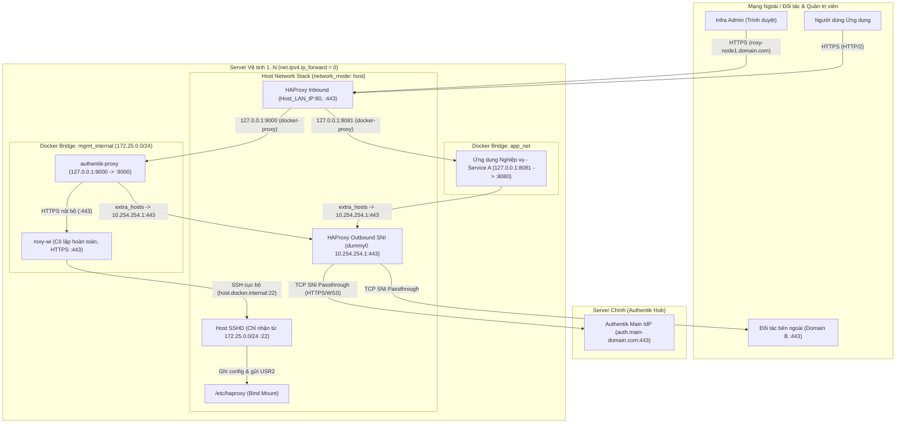
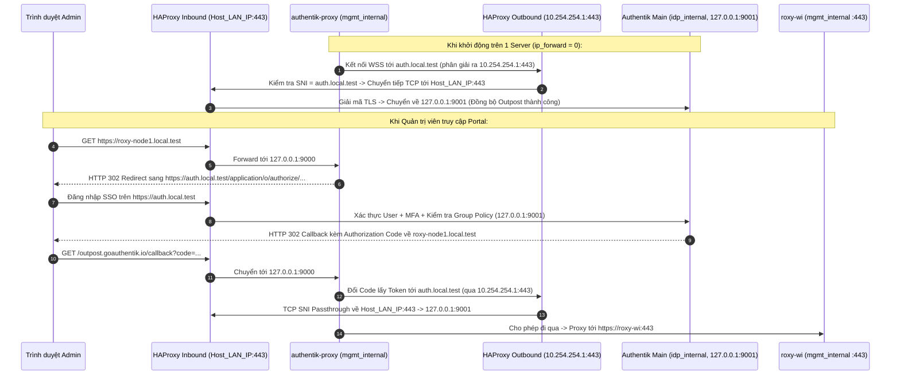

# BUSINESS & TECHNICAL REQUIREMENTS DOCUMENT (BRD)
## Dự án: Nền tảng Proxy Tập trung HAProxy (Zero-IP-Forward) & Portal Quản trị Xác thực Tập trung (Authentik SSO + Roxy-WI)

| Thông tin tài liệu | Chi tiết |
| :--- | :--- |
| **Mã dự án** | `RPA-PRORY` |
| **Phiên bản** | `1.0.0` |
| **Ngày lập** | `2026-11-25` |
| **Trạng thái** | Bản thảo hoàn chỉnh — Sẵn sàng cho giai đoạn Phát triển & Kiểm thử PoC |
| **Phạm vi triển khai** | Hỗ trợ đồng thời **Mô hình 1 Server (Local/PoC All-in-One)** và **Mô hình Đa Server (Production Hub & Spoke)** |

---

## 1. Bối cảnh & Đặt vấn đề (Background & Problem Statement)

### 1.1. Hiện trạng & Thách thức
1. **Rủi ro cảnh báo bảo mật (CVE):** Hệ thống reverse proxy hiện hữu dùng NGINX phát sinh nhiều cảnh báo lỗ hổng bảo mật liên quan đến bộ nhớ và thư viện đi kèm, gây áp lực lên quy trình kiểm toán an toàn thông tin (Security Audit).
2. **Ràng buộc hạ tầng mạng nghiêm ngặt (OS & Firewall Hardening):**
   * Toàn bộ máy chủ bắt buộc tắt định tuyến gói tin ở tầng Kernel: `net.ipv4.ip_forward = 0`.
   * Các ứng dụng nghiệp vụ chạy trong Docker ở chế độ mạng `bridge` cô lập (không được phép chạy `network_mode: host`). Khi `ip_forward = 0`, các container này hoàn toàn mất khả năng gọi trực tiếp ra Internet hoặc tới các hệ thống đối tác bên ngoài.
   * Chính sách Firewall giữa các máy chủ **cấm mở cổng quản trị SSH (`Port 22`) liên server**, gây cản trở cho các công cụ quản trị tập trung truyền thống vốn dựa vào kết nối SSH từ xa.
3. **Nhu cầu vận hành tập trung & kiểm soát truy cập chặt chẽ:**
   * Đội ngũ vận hành cần giao diện Web UI mã nguồn mở (Roxy-WI Community Edition) để quản lý cấu hình, theo dõi trạng thái/log và reload HAProxy mà không tốn chi phí bản quyền thương mại.
   * Tuy nhiên, bản Community không tích hợp sẵn OIDC/SSO và bản thân các công cụ quản trị web từng ghi nhận nhiều lỗ hổng nghiêm trọng (như `CVE-2026-33076`, `CVE-2026-33078`, `CVE-2026-22265`). Do đó, hệ thống bắt buộc phải có lớp cổng xác thực SSO/OIDC đứng chắn phía trước để triệt tiêu toàn bộ truy cập chưa xác thực (Pre-auth).

### 1.2. Tầm nhìn Giải pháp
Xây dựng một bộ khung cấu hình và tự động hóa triển khai (Infrastructure-as-Code) hoàn chỉnh dựa trên **HAProxy + Authentik Proxy Outpost + Roxy-WI**, cho phép:
* Xử lý đồng thời lưu lượng **Inbound (HTTPS/HTTP2)** và **Outbound (TCP SNI Passthrough)** ngay trên từng máy chủ với `net.ipv4.ip_forward = 0`, không cần sửa mã nguồn hay can thiệp chứng chỉ SSL của ứng dụng.
* Bọc xác thực SSO tập trung qua **Authentik** cho toàn bộ các Portal quản trị Roxy-WI trên nhiều máy chủ vệ tinh mà không cần mở SSH liên server.
* Hỗ trợ **chế độ triển khai linh hoạt**: chạy trọn bộ trên **01 máy chủ duy nhất (Local/Dev Test Lab — cài đồng thời Authentik Main + Authentik Proxy + HAProxy + Roxy-WI)** để phát triển/kiểm thử đúng luồng thực tế trước khi tách thành **Cụm Đa Server (1 Hub + N Satellite Nodes)** trên Production.

---

## 2. Mục tiêu Dự án & Chỉ số Thành công (Objectives & KPIs)

| Mã | Mục tiêu | Chỉ số đo lường thành công (KPIs) |
| :--- | :--- | :--- |
| **BO-01** | **Tuân thủ tuyệt đối Hardening hạ tầng** | `sysctl net.ipv4.ip_forward` luôn bằng `0` (kể cả sau khi restart Docker hoặc reboot OS); `0` kết nối SSH mở giữa các server trên mạng LAN; `0` port nội bộ của container bị lộ trực tiếp ra LAN. |
| **BO-02** | **Tương thích 100% ứng dụng hiện hữu** | `0` dòng code ứng dụng phải sửa đổi; `0` chứng chỉ Root CA nội bộ phải cài vào container nghiệp vụ; hỗ trợ đầy đủ HTTP/2 chiều vào và giữ nguyên chứng chỉ SSL gốc (kể cả mTLS) chiều ra. |
| **BO-03** | **An toàn bảo mật Portal Quản trị & Tối ưu chi phí** | `100%` request chưa đăng nhập vào Roxy-WI bị chặn ở lớp `authentik-proxy` (HTTP `302`/`403`); tiết kiệm `100%` chi phí license Enterprise nhờ kiến trúc Proxy Outpost mã nguồn mở. |
| **BO-04** | **Vận hành ổn định chuẩn Production** | Reload cấu hình HAProxy đạt **Zero-Downtime** (`0` request bị rớt khi reload); sự cố DNS của domain đối tác bên ngoài không làm gián đoạn chiều Inbound; thời gian dựng mới 1 node vệ tinh hoặc môi trường test 1-server dưới `15 phút`. |

---

## 3. Phạm vi Dự án (Project Scope)

### 3.1. Trong phạm vi (In-Scope)
* Thiết lập kịch bản chuẩn hóa hệ điều hành Host: cấu hình `sysctl`, interface ảo `dummy0` cố định IP Outbound, cấu hình `/etc/docker/daemon.json`, phân quyền thư mục `/etc/haproxy`, user SSH đặc quyền tối thiểu và rule Firewall nội bộ.
* Xây dựng cấu hình chuẩn cho **HAProxy container (`network_mode: host`)**: tách biệt listener Inbound (L7 HTTP/2 + TLS Termination) và listener Outbound (L4 TCP SNI Passthrough + DNS Resolver an toàn).
* Đóng gói cụm quản trị vệ tinh bằng Docker Compose: **Authentik Proxy Outpost** + **Roxy-WI** trên mạng nội bộ cô lập `mgmt_internal`.
* Đóng gói cụm **Authentik Main (IdP)** dùng cho môi trường **Local/Single-Server Test** (và tài liệu/blueprint tích hợp với Authentik Main trên Production).
* Xây dựng container ứng dụng mẫu (**Mock Service A**) để kiểm thử tự động cả 2 chiều Inbound và Outbound.
* Xây dựng bộ công cụ vận hành & cứu hộ sự cố (**Break-glass CLI scripts**): kiểm tra cú pháp trước reload, khôi phục cấu hình khi HAProxy lỗi.

### 3.2. Ngoài phạm vi (Out-of-Scope)
* Sửa đổi mã nguồn nghiệp vụ của các ứng dụng hiện có hoặc can thiệp vào mã nguồn nội bộ của Roxy-WI Community để bỏ màn hình đăng nhập cục bộ bên trong Roxy-WI.
* Quản lý lưu lượng Outbound cho các giao thức phi chuẩn không dùng tên miền/TLS SNI (VD: gọi thẳng bằng địa chỉ IP trần, UDP thô, hoặc dải port động FTP thụ động).
* Triển khai hệ thống cân bằng tải đa vùng địa lý (Global Server Load Balancing) hoặc WAF chuyên sâu tầng L7 (có thể mở rộng ở giai đoạn sau).

---

## 4. Đối tượng Sử dụng & Ma trận Phân quyền (Stakeholders & RBAC)

| Vai trò | Nhu cầu sử dụng | Quyền hạn trên hệ thống |
| :--- | :--- | :--- |
| **Infra / Platform Admin** | Cấu hình định tuyến Inbound/Outbound, cập nhật chứng chỉ SSL, reload HAProxy, xem log/metrics trên các node. | Thuộc Group `infra-admins` trên Authentik (bắt buộc bật MFA); được phép đi qua `authentik-proxy` vào Roxy-WI trên các server vệ tinh được cấp quyền; có quyền truy cập kênh Console/Bastion cứu hộ khẩn cấp. |
| **App Developer / DevOps** | Khai báo port expose của container nghiệp vụ và danh sách tên miền đối tác (`Domain B`) cần gọi ra ngoài. | Không truy cập trực tiếp Roxy-WI Production (hoặc chỉ có quyền Read-only nếu được cấp); gửi yêu cầu mở whitelist domain qua quy trình vận hành. |
| **Security Auditor** | Rà soát tuân thủ `ip_forward = 0`, quét CVE container, kiểm tra log truy cập SSO và cấu hình TLS. | Quyền xem Audit Log trên Authentik Main, kiểm tra cấu hình hệ thống định kỳ. |
| **Người dùng ngoài / Chưa cấp quyền** | Truy cập các ứng dụng nghiệp vụ công khai qua chiều Inbound; không được phép chạm tới Portal quản trị. | Chỉ truy cập được các domain nghiệp vụ Inbound; bị chặn `302` (chưa đăng nhập) hoặc `403 Forbidden` (sai Group Policy) ngay tại `authentik-proxy` trước khi chạm tới Roxy-WI. |

---

## 5. Kiến trúc Giải pháp Tổng thể (System Architecture)

Hệ thống được thiết kế theo kiến trúc mô-đun thống nhất, cho phép chạy ở **2 chế độ triển khai** mà **không phải thay đổi cấu trúc mạng hay cơ chế định tuyến của HAProxy**.

### 5.1. Nguyên lý Cốt lõi Vượt Ràng buộc `net.ipv4.ip_forward = 0`
Khi `net.ipv4.ip_forward = 0`, Linux Kernel từ chối chuyển tiếp gói tin đi xuyên từ card mạng này sang card mạng khác (chain `FORWARD`). Giải pháp hóa giải hợp pháp ràng buộc này bằng cách chuyển toàn bộ luồng mạng thành **giao tiếp cục bộ tới/từ chính Host** (chain `INPUT` và `OUTPUT`):
1. **Chiều Inbound:** Client ngoài gọi tới `<Host_LAN_IP>:443` → HAProxy (chạy `network_mode: host`) nhận gói tin tại chain `INPUT`, giải mã TLS/HTTP2, rồi mở kết nối mới từ Host tới `127.0.0.1:<port_expose>` → tiến trình `docker-proxy` ở userspace tiếp nhận và chuyển thẳng vào container ứng dụng.
2. **Chiều Outbound:** Container trong mạng `bridge` phân giải `<domain-b>` (nhờ `extra_hosts: "<domain-b>:host-gateway"`) về IP ảo cố định `10.254.254.1` trên interface `dummy0` của Host → gói tin đi vào chain `INPUT` của Host tại `10.254.254.1:443` → HAProxy đọc trường `SNI` trong gói `TLS ClientHello` (không giải mã TLS), đối chiếu danh sách cho phép (Whitelist) rồi dùng stack mạng của Host mở kết nối TCP thẳng ra `<domain-b>:443` bên ngoài.

### 5.2. Chế độ 1: Mô hình Sản xuất Đa Server (Multi-Server Production)
Gồm **01 Server Chính** vận hành `Authentik Main (IdP)` và **N Server Vệ tinh** vận hành độc lập bộ `HAProxy + Authentik Proxy + Roxy-WI + Ứng dụng nghiệp vụ`. Giữa các server chỉ giao tiếp qua cổng `443` (HTTPS/WSS), hoàn toàn không mở SSH liên server.



### 5.3. Chế độ 2: Mô hình Kiểm thử / Phát triển trên 01 Server Duy nhất (Single-Server Lab / PoC)
Trong giai đoạn phát triển hoặc khi chỉ có **01 máy chủ duy nhất**, hệ thống triển khai **cả `Authentik Main` lẫn `Authentik Proxy` tách rời trên cùng một máy** (thay vì dùng Embedded Outpost có sẵn của Authentik Main) nhằm **mô phỏng chính xác 100% đường đi mạng của Server Vệ tinh**:



> **Giá trị cốt lõi của thiết kế 1-Server này:** Khi chuyển từ môi trường 1-Server Local lên Production Đa Server, toàn bộ cấu hình của cụm Vệ tinh (`HAProxy`, `authentik-proxy`, `roxy-wi`, script OS) **giữ nguyên 100%**, chỉ thay đổi duy nhất biến môi trường tên miền và IP đích của `Authentik Main` trong file `.env`.

---

## 6. Yêu cầu Chức năng Chi tiết (Functional Requirements)

### FR-01: Chuẩn hóa Hệ điều hành Host, Dummy Interface & Docker Daemon
1. **Khóa cứng `ip_forward = 0` bền vững qua Reboot:**
   * Thiết lập `net.ipv4.ip_forward = 0` trong `/etc/sysctl.d/99-security-hardening.conf`.
   * Cấu hình `/etc/docker/daemon.json` với `"ip-forward": false` để ngăn Docker Daemon tự động bật lại `ip_forward = 1` khi khởi động dịch vụ.
2. **Thiết lập Giao diện mạng ảo `dummy0` cho chiều Outbound:**
   * Khởi tạo interface `dummy0` ở tầng OS (qua `systemd-networkd` hoặc `NetworkManager`) mang địa chỉ IP tĩnh `10.254.254.1/32`, tự động kích hoạt trước `docker.service`.
   * Cấu hình `"host-gateway-ip": "10.254.254.1"` trong `/etc/docker/daemon.json`. Mọi khai báo `extra_hosts: "<domain>:host-gateway"` từ bất kỳ bridge network nào đều trỏ đồng nhất về `10.254.254.1`, đồng thời đảm bảo HAProxy không bao giờ mất IP lắng nghe khi các mạng Docker được tạo mới hoặc xóa đi (`docker compose down`).
   * Đảm bảo cấu hình `rp_filter` trên các interface `br-*` không chặn gói tin cục bộ đi tới `10.254.254.1`.
3. **Bảo vệ Port Publish mặc định của Docker:**
   * Giữ `"userland-proxy": true` và đặt `"ip": "127.0.0.1"` trong `/etc/docker/daemon.json` để mọi container publish port mặc định chỉ gắn vào loopback `127.0.0.1`, ngăn chặn truy cập vượt mặt HAProxy từ mạng LAN.
4. **Cấu hình Firewall trên Host (`iptables` / `firewalld` / `ufw`):**
   * Cho phép traffic trên card mạng vật lý vào `<Host_LAN_IP>:80` và `<Host_LAN_IP>:443`.
   * Cho phép traffic ở chain `INPUT` từ các interface bridge của Docker (`docker0`, `br-*`) đi tới `10.254.254.1:443` (và `:80` nếu bật Outbound HTTP).
   * Cho phép traffic ở chain `INPUT` **chỉ riêng từ dải mạng quản trị `mgmt_internal` (`172.25.0.0/24`)** đi tới cổng SSH (`TCP 22`) của chính Host đó để container `roxy-wi` thực thi tác vụ quản trị; chặn hoàn toàn cổng `22` giữa các server theo quy định bảo mật.

### FR-02: Định tuyến Chiều Inbound trên HAProxy (HTTPS / HTTP/2)
1. Triển khai HAProxy bằng container image tối giản bản LTS (VD: `haproxy:3.0-alpine` hoặc `haproxy:3.2-alpine`) với `network_mode: host`.
2. Cấu hình Frontend Inbound HTTP (`<Host_LAN_IP>:80`) tự động chuyển hướng `HTTP 301` sang `HTTPS`.
3. Cấu hình Frontend Inbound HTTPS (`<Host_LAN_IP>:443`):
   * Bật TLS Termination (tối thiểu `TLSv1.2`, ưu tiên `TLSv1.3`) và đàm phán `alpn h2,http/1.1`.
   * Làm sạch và gắn đầy đủ các header chuyển tiếp: `X-Forwarded-For` (`option forwardfor`), `X-Forwarded-Proto: https`, giữ nguyên `Host` header.
   * Cấu hình `tune.bufsize 32768` trong block `global` để xử lý an toàn các cookie phiên OIDC kích thước lớn của Authentik mà không gây lỗi `400 Bad Request`.
4. Định tuyến dựa trên `Host` header về các cổng loopback tương ứng trên Host (`127.0.0.1:<port_expose>`):
   * Domain ứng dụng nghiệp vụ → `127.0.0.1:<app_port>`
   * Domain Roxy-WI của node (`roxy-nodeX.domain.com`) → `127.0.0.1:9000` (`authentik-proxy`)
   * *(Chỉ trong chế độ Local 1-Server)* Domain Authentik Main (`auth.local.test`) → `127.0.0.1:9001` (`authentik-server`)

### FR-03: Định tuyến Chiều Outbound trên HAProxy (TCP SNI Passthrough)
1. Cấu hình Frontend Outbound TLS lắng nghe cố định trên `10.254.254.1:443` ở chế độ `mode tcp`:
   * Thiết lập `tcp-request inspect-delay 5s` và chỉ chấp nhận gói `TLS ClientHello` hợp lệ (`req.ssl_hello_type 1`).
   * Thiết lập quy tắc từ chối mặc định (`tcp-request content reject` / không khai báo `default_backend`) đối với mọi kết nối không chứa SNI hoặc SNI không nằm trong danh sách Whitelist.
2. Định tuyến theo ACL `req.ssl_sni -i <domain>` sang các Backend tương ứng mà **không giải mã TLS**:
   * Với các domain đối tác bên ngoài (`Domain B`): sử dụng block `resolvers` đọc DNS thật của Host (tránh stub `127.0.0.53`), cấu hình bắt buộc `accepted_payload_size 8192`, `resolve-prefer ipv4`, `default-server init-addr last,libc,none` và **không bật active health check (`check`)** để tránh bị đối tác chặn IP hoặc làm treo HAProxy khi DNS đối tác gặp sự cố.
   * Với domain của `Authentik Main` (`auth.main-domain.com` hoặc `auth.local.test`): ưu tiên trỏ thẳng về IP tĩnh `<Authentik_Main_IP>:443` (trên môi trường 1-Server là `<Host_LAN_IP>:443`), cấu hình `timeout client`/`timeout server` dài (`300s`–`3600s`) kèm `option clitcpka` và `option srvtcpka` để giữ kết nối WebSocket Outpost (`/ws/outpost/`) ổn định không bị ngắt quãng.
3. *(Tùy chọn mở rộng)* Nếu có ứng dụng cần gọi HTTP thuần (Port `80`) ra ngoài: tách một Frontend Outbound riêng trên `10.254.254.1:80` chạy ở `mode http` và lọc Whitelist theo header `hdr(host)`.

### FR-04: Tích hợp Ứng dụng Nghiệp vụ (Service A) & Ứng dụng Kiểm thử (Mock App)
1. Các ứng dụng nghiệp vụ giữ nguyên chế độ mạng `bridge` độc lập của từng dự án.
2. Cấu hình `ports` chỉ lắng nghe trên loopback: `"127.0.0.1:<port_expose>:<container_port>"`.
3. Khai báo danh sách các domain cần gọi ra ngoài trong `extra_hosts` với cú pháp chuẩn `"<domain-b>:host-gateway"`.
4. Dự án cung cấp sẵn một **Mock Service A** để phục vụ kiểm thử tự động: trả về thông tin HTTP/headers khi gọi Inbound, và có endpoint/script kiểm tra gọi HTTPS Outbound ra domain mẫu bên ngoài.

### FR-05: Xác thực Tập trung với Authentik Main & Authentik Proxy Outpost
1. **Đồng bộ phiên bản nghiêm ngặt:** Container `ghcr.io/goauthentik/proxy:${AUTHENTIK_TAG}` trên tất cả các server vệ tinh bắt buộc ghim cứng phiên bản khớp chính xác với `ghcr.io/goauthentik/server:${AUTHENTIK_TAG}` trên Server chính (tuyệt đối không dùng tag `:latest`).
2. **Cấu hình trên Authentik Main:**
   * Với mỗi server vệ tinh (hoặc node local), khởi tạo bộ **Proxy Provider (Mode: Standalone Proxy) + Application + Outpost riêng biệt** để cô lập phạm vi ảnh hưởng của `AUTHENTIK_TOKEN`.
   * Thông số Proxy Provider:
     * `External host`: `https://roxy-nodeX.domain.com`
     * `Internal host`: `https://roxy-wi:443`
     * `Internal host SSL Validation`: **`false`** (do chứng chỉ bên trong container Roxy-WI là tự ký).
     * `Authorization flow`: Chọn luồng **`Implicit consent`** để người dùng đã đăng nhập SSO chuyển giữa các server vệ tinh không phải bấm xác nhận lại.
   * Gắn Policy/Group binding: chỉ cho phép thành viên nhóm quản trị hạ tầng (đã xác thực MFA) truy cập; các tài khoản khác nhận mã `403 Forbidden` ngay tại tầng Proxy.
   * Cung cấp **Authentik Blueprint (YAML)** tự động hóa việc tạo Provider/App/Outpost để dễ dàng khởi tạo nhanh ở môi trường Local 1-Server cũng như nhân bản hàng loạt trên Production.
3. **Cấu hình container `authentik-proxy` trên Server vệ tinh:**
   * Đặt trong mạng nội bộ `mgmt_internal` (`172.25.0.0/24`), chỉ mở port `"127.0.0.1:9000:9000"`.
   * Khai báo `"auth.main-domain.com:host-gateway"` trong `extra_hosts` để mọi lưu lượng xác thực và WebSocket đi qua HAProxy Outbound SNI Passthrough.
   * Hỗ trợ biến `AUTHENTIK_INSECURE` (chỉ bật `"true"` khi dùng chứng chỉ tự ký ở môi trường Local Test; bắt buộc `"false"` trên Production).

### FR-06: Portal Quản trị Roxy-WI & Cơ chế SSH Đặc quyền Tối thiểu
1. Sử dụng phiên bản Roxy-WI đã vá các lỗ hổng thực thi mã từ xa và tiêm lệnh (tối thiểu từ `8.2.8.2` trở lên hoặc nhánh container chính thức `9.1.x+`).
2. Cô lập hoàn toàn trong mạng `mgmt_internal`, **không khai báo `ports` ra Host**, chỉ nhận lưu lượng từ `authentik-proxy`.
3. Gắn đầy đủ các Docker Volumes lưu trữ bền vững dữ liệu (`/var/lib/roxy-wi`, `/etc/roxy-wi`, SSH keys) để không mất cấu hình khi nâng cấp/tái tạo container.
4. **Cơ chế kết nối SSH an toàn từ Roxy-WI vào Host vệ tinh:**
   * Roxy-WI kết nối tới chính Host chứa nó qua địa chỉ `host.docker.internal:22` (ánh xạ về `10.254.254.1` hoặc gateway của `mgmt_internal`).
   * Tạo tài khoản hệ thống riêng `roxyadmin` trên Host, **tuyệt đối không thêm vào group `docker`**.
   * Cấp quyền đọc/ghi chia sẻ trên `/etc/haproxy` giữa `roxyadmin` và user `haproxy` (UID `99` trong container) thông qua Group chung (`setgid` `chmod 2770`) hoặc POSIX ACL để không lỗi quyền đọc chứng chỉ `.pem` và file cấu hình.
   * Giới hạn `sudoers` cho `roxyadmin` chỉ được phép chạy các script/lệnh wrapper kiểm tra cấu hình (`haproxy -c -V -f`), xem trạng thái/log container HAProxy và gửi tín hiệu reload (`docker kill -s USR2 haproxy`).

### FR-07: Vận hành Zero-Downtime Reload & Công cụ Cứu hộ (Break-Glass)
1. Cấu hình HAProxy chạy chế độ `master-worker` (`-W`) kèm chỉ thị `hard-stop-after 60s` để giải phóng dứt điểm các tiến trình worker cũ sau khi reload, tránh rò rỉ bộ nhớ.
2. Mọi lệnh reload kích hoạt từ Roxy-WI hoặc CLI đều phải đi qua bước kiểm tra cú pháp tự động (`docker exec haproxy haproxy -c -V -f /usr/local/etc/haproxy/haproxy.cfg`); nếu cấu hình lỗi, giữ nguyên tiến trình đang chạy và trả mã lỗi rõ ràng.
3. Cung cấp bộ script CLI cục bộ trên Host (`scripts/haproxy-ctl.sh`) hỗ trợ: backup tự động trước mỗi lần sửa, rollback về bản cấu hình hợp lệ gần nhất và khởi động lại HAProxy ngay từ Console/Bastion khi mất đường vào Web UI.

---

## 7. Yêu cầu Phi Chức năng (Non-Functional Requirements)

| Nhóm | Yêu cầu chi tiết |
| :--- | :--- |
| **Bảo mật (Security)** | - Container HAProxy phải được khóa quyền: `cap_drop: ["ALL"]`, `cap_add: ["NET_BIND_SERVICE"]`, `security_opt: ["no-new-privileges:true"]` nhằm ngăn chặn leo thang đặc quyền ngay cả khi file `haproxy.cfg` bị can thiệp.<br>- Toàn bộ biến nhạy cảm (`AUTHENTIK_TOKEN`, `SECRET_KEY`, mật khẩu DB Local IdP, đường dẫn SSH key) phải quản lý qua file `.env` phân quyền `0600`, không lưu cứng trong Git. |
| **Độ tin cậy (Reliability)** | - Đạt `0%` tỷ lệ lỗi kết nối ở các luồng đang mở khi thực hiện reload cấu hình.<br>- Tự động phục hồi đầy đủ trạng thái các dịch vụ (`restart: unless-stopped`, systemd unit cho `dummy0`) sau khi máy chủ khởi động lại mà không cần thao tác tay. |
| **Khả năng Bảo trì & Mở rộng (Maintainability)** | - Mã nguồn cấu hình tổ chức dạng mô-đun rõ ràng; phân tách cấu hình môi trường (`local-single-node` vs `prod-hub` / `prod-satellite`) hoàn toàn qua Docker Compose Profiles và biến môi trường.<br>- Khi số lượng domain Outbound tăng lớn và biến động liên tục trong tương lai, kiến trúc cho phép cắm thêm một Forward Proxy nhẹ (như Tinyproxy trên Host) cho các ứng dụng hỗ trợ `HTTPS_PROXY` mà không phá vỡ cấu trúc hiện tại. |

---

## 8. Giả định, Ràng buộc & Quản trị Rủi ro (Assumptions & Risk Matrix)

### 8.1. Ràng buộc & Thống nhất Kỳ vọng Nghiệm thu
1. **Hành vi đăng nhập 2 lớp ("Double Login") với Roxy-WI Community:**
   * Do Roxy-WI bản Community không hỗ trợ tự động ánh xạ HTTP Header (`X-authentik-username`) sang phiên đăng nhập nội bộ, việc tích hợp `authentik-proxy` đóng vai trò **cổng xác thực SSO bảo vệ lớp ngoài**: quản trị viên đăng nhập SSO 1 lần trên Authentik sẽ tự động đi qua lớp cổng bảo vệ của tất cả các server vệ tinh, sau đó đăng nhập phiên cục bộ bên trong giao diện Roxy-WI. Hành vi này được xác nhận là chuẩn thiết kế để không phải can thiệp mã nguồn Roxy-WI hoặc mua gói Enterprise.
2. **Phạm vi Outbound SNI Passthrough:**
   * Áp dụng cho các kết nối TLS/HTTPS gọi bằng tên miền trên cổng đã định nghĩa (mặc định `443`). Không áp dụng cho các kết nối gọi thẳng bằng địa chỉ IP trần (do không có trường SNI và không đi qua phân giải tên miền `extra_hosts`).

### 8.2. Ma trận Rủi ro & Biện pháp Kiểm soát

| Mã | Rủi ro | Mức độ | Biện pháp giảm thiểu trong thiết kế |
| :--- | :--- | :---: | :--- |
| **R-01** | Phụ thuộc vòng (Circular Dependency): Lỗi cấu hình HAProxy hoặc đứt kết nối tới Authentik Main làm khóa luôn giao diện Roxy-WI trên server vệ tinh. | Cao | Bắt buộc kiểm tra `haproxy -c` trước khi gửi `USR2`; trang bị script cứu hộ `haproxy-ctl.sh rollback` qua kênh truy cập Out-of-Band Console / Bastion nội bộ. |
| **R-02** | Xung đột IP `host-gateway` hoặc mất interface mạng khi `docker compose down` làm HAProxy không khởi động được. | Cao | Sử dụng interface ảo `dummy0` (`10.254.254.1/32`) khởi tạo từ OS kết hợp `"host-gateway-ip": "10.254.254.1"` trong `daemon.json`, tách rời hoàn toàn khỏi vòng đời mạng Docker. |
| **R-03** | Lỗi DNS của đối tác bên ngoài làm HAProxy từ chối reload, kéo sập luôn chiều Inbound. | Cao | Bắt buộc khai báo `default-server init-addr last,libc,none`, `resolve-prefer ipv4` và tắt health check chủ động cho các domain ngoài. |
| **R-04** | Khai thác lỗ hổng Post-Auth trên Roxy-WI hoặc leo thang đặc quyền qua SSH user. | Trung bình | Ghim bản Roxy-WI đã vá lỗi (`>= 8.2.8.2` / `9.1.x+`), bật MFA trên Authentik, không gán group `docker` cho user SSH, giới hạn `sudo` qua wrapper script và khóa capabilities của container HAProxy. |
| **R-05** | Đứt kết nối WebSocket Outpost hoặc lỗi `400 Cookie Too Large` sau khi đăng nhập SSO. | Trung bình | Tăng `tune.bufsize 32768`, bật TCP keepalive và tăng timeout cho backend Outbound nối về Authentik Main. |

---

## 9. Đề xuất Cấu trúc Dự án & Lộ trình Triển khai (Project Structure & Roadmap)

### 9.1. Cấu trúc Thư mục Dự án (`rpa-prory`)
```text
rpa-prory/
├── BRD.md                          # Tài liệu đặc tả yêu cầu nghiệp vụ & kỹ thuật
├── .env.example                    # Mẫu biến môi trường (hỗ trợ cả Local 1-Server & Prod)
├── docker-compose.yml              # Stack chính (HAProxy + Satellite Mgmt: authentik-proxy, roxy-wi)
├── docker-compose.local-idp.yml    # Stack mở rộng cho Local Test 1-Server (Authentik Main + Mock App)
├── host-setup/
│   ├── daemon.json.tpl             # Mẫu cấu hình /etc/docker/daemon.json chuẩn hardening
│   ├── 99-haproxy-zero-fwd.conf    # Cấu hình sysctl (ip_forward=0, rp_filter)
│   ├── dummy0.netdev               # Cấu hình interface ảo 10.254.254.1/32
│   ├── sudoers-roxyadmin           # Quyền sudo đặc quyền tối thiểu cho Roxy-WI SSH user
│   └── bootstrap-host.sh           # Script cài đặt tự động tầng OS, ACL thư mục & Firewall
├── haproxy/
│   ├── haproxy.cfg.tpl             # Cấu hình HAProxy chuẩn (Inbound HTTP/2 + Outbound SNI)
│   └── certs/                      # Thư mục chứa chứng chỉ TLS (gồm script tạo cert local mkcert/openssl)
├── authentik/
│   └── blueprints/                 # Blueprint tự động khởi tạo Provider, App, Group & Outpost
├── mock-app/                       # Container ứng dụng mẫu (Service A) để test Inbound & Outbound
└── scripts/
    ├── haproxy-ctl.sh              # Wrapper validate, zero-downtime reload, backup & rollback
    └── verify-acceptance.sh        # Script chạy tự động toàn bộ bài test nghiệm thu
```

### 9.2. Lộ trình Phát triển 4 Giai đoạn
* **Giai đoạn 1 — Nền tảng OS & Lõi HAProxy (Inbound/Outbound):** Viết script `bootstrap-host.sh` thiết lập `ip_forward = 0`, `dummy0`, `daemon.json`, Firewall; dựng container HAProxy và `mock-app` chứng minh thành công cả 2 chiều Inbound HTTP/2 và Outbound SNI Passthrough trên 1 máy.
* **Giai đoạn 2 — Tích hợp Authentik Main + Authentik Proxy + Roxy-WI trên 1 Server (Local Lab):** Dựng stack `docker-compose.local-idp.yml` cùng stack vệ tinh trên 1 máy; xác thực thành công vòng lặp `authentik-proxy` đi qua HAProxy Outbound SNI Passthrough về `Authentik Main` nội bộ và bọc SSO trước `roxy-wi`.
* **Giai đoạn 3 — Hardening Bảo mật, SSH Least-Privilege & Công cụ Cứu hộ:** Thiết lập user `roxyadmin`, ACL `/etc/haproxy`, kết nối Roxy-WI quản trị HAProxy qua SSH cục bộ, hoàn thiện `haproxy-ctl.sh` và bộ script kiểm thử tự động `verify-acceptance.sh`.
* **Giai đoạn 4 — Đóng gói Tài liệu Vận hành & Chuyển giao Triển khai Đa Server:** Tách cấu hình `.env` chuẩn cho Server Chính và các Server Vệ tinh, chạy thử nghiệm UAT và nghiệm thu toàn diện.

---

## 10. Tiêu chí Nghiệm thu Toàn diện (Master Acceptance Criteria)

### Nhóm A: Hạ tầng OS, Docker & Cô lập Mạng
- [ ] **AC-A1:** Lệnh `sysctl net.ipv4.ip_forward` trên Host trả về `0` cả trước và sau khi chạy `systemctl restart docker` cũng như sau khi reboot máy chủ.
- [ ] **AC-A2:** Interface `dummy0` (`10.254.254.1/32`) tự động lên khi khởi động máy; HAProxy khởi động và reload thành công ngay cả khi toàn bộ các mạng Docker ứng dụng và quản trị đang tắt (`docker compose down`).
- [ ] **AC-A3:** Từ một máy khác trong mạng LAN, quét hoặc gọi trực tiếp vào `<Host_LAN_IP>:<port_expose>` của ứng dụng, cổng `9000` (`authentik-proxy`), cổng `9001` (`authentik-server` bản 1-server) và Roxy-WI đều bị từ chối kết nối.
- [ ] **AC-A4:** Giữa các máy chủ không mở cổng SSH (`Port 22`) trên mạng LAN, nhưng bên trong Server vệ tinh container `roxy-wi` vẫn SSH cục bộ thành công vào `host.docker.internal:22`.

### Nhóm B: Luồng Inbound & Outbound Nghiệp vụ (Service A)
- [ ] **AC-B1 (Inbound HTTP/2):** Gọi `curl -I --http2 https://<app-domain>` từ bên ngoài trả về giao thức `HTTP/2 200`, định tuyến đúng vào container `Service A` và ứng dụng nhận đủ header `X-Forwarded-For`, `X-Forwarded-Proto: https`; gọi HTTP cổng `80` tự động trả về `301` sang `HTTPS`.
- [ ] **AC-B2 (Outbound SNI Whitelist — Hợp lệ):** Bên trong container `Service A`, lệnh `getent hosts <domain-b>` trả về `10.254.254.1`; lệnh `curl -Iv https://<domain-b>` kết nối thành công `200 OK` và xác thực đúng chứng chỉ SSL gốc của `<domain-b>`.
- [ ] **AC-B3 (Outbound SNI Whitelist — Từ chối):** Bên trong container `Service A`, khi thử gọi HTTPS tới một tên miền bất kỳ **không** nằm trong danh sách cho phép (kể cả khi cố tình ép phân giải về `10.254.254.1`), kết nối bị HAProxy từ chối ngay lập tức.

### Nhóm C: Xác thực SSO (Authentik) & Portal Quản trị (Roxy-WI)
- [ ] **AC-C1 (Kết nối Outpost qua SNI Passthrough):** Log của container `authentik-proxy` ghi nhận kết nối HTTPS/WebSocket (`/ws/outpost/`) thành công và duy trì ổn định tới `Authentik Main` xuyên qua HAProxy Outbound trong điều kiện `net.ipv4.ip_forward = 0` (cả trên bản test 1-Server lẫn bản Đa Server).
- [ ] **AC-C2 (Chặn Pre-Auth 100%):** Truy cập trực tiếp bất kỳ đường dẫn nào trên `https://roxy-node1.<domain>` (bao gồm cả các URI API/static của Roxy-WI) khi chưa đăng nhập đều bị chặn và chuyển hướng `HTTP 302` về trang đăng nhập của `Authentik Main`.
- [ ] **AC-C3 (Kiểm soát Phân quyền RBAC):** Đăng nhập bằng tài khoản hợp lệ trên Authentik nhưng **không** thuộc Group quản trị hạ tầng bị chặn với mã `HTTP 403 Forbidden` ngay tại lớp `authentik-proxy`, hoàn toàn không chạm được tới container `roxy-wi`.
- [ ] **AC-C4 (SSO Đa Node):** Khi đăng nhập thành công 1 lần bằng tài khoản thuộc Group quản trị trên `Authentik Main`, mở liên tiếp URL của nhiều server vệ tinh khác nhau tự động vượt qua lớp cổng `authentik-proxy` mà không phải xác thực lại OIDC.

### Nhóm D: Vận hành, Bảo mật Đặc quyền & Phục hồi Sự cố
- [ ] **AC-D1 (Quản trị & Zero-Downtime Reload):** Sửa cấu hình và bấm Reload HAProxy từ giao diện Roxy-WI hoạt động không lỗi trong khi đang bắn tải liên tục (`0` request bị ngắt kết nối); các tiến trình worker cũ tự động thu hồi sau thời gian `hard-stop-after`.
- [ ] **AC-D2 (Chống sập do cấu hình sai hoặc lỗi DNS ngoài):** Khi cố tình nhập sai cú pháp `haproxy.cfg` hoặc khi một `<domain-b>` bên ngoài không phân giải được DNS, tiến trình HAProxy hiện hành vẫn tiếp tục phục vụ bình thường chiều Inbound, không bị sập dịch vụ.
- [ ] **AC-D3 (Bảo toàn dữ liệu & Giới hạn đặc quyền):** Chạy `docker compose down && docker compose up -d` đối với cụm `roxy-wi` không làm mất cấu hình đã lưu; user SSH `roxyadmin` không nằm trong group `docker` và không thể thực thi lệnh trái phép ngoài danh sách cho phép trong `sudoers`.
